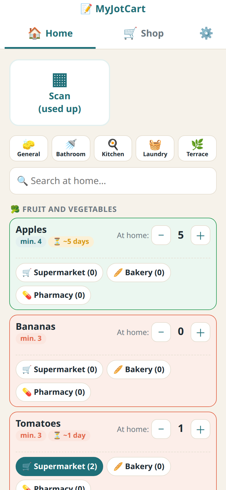
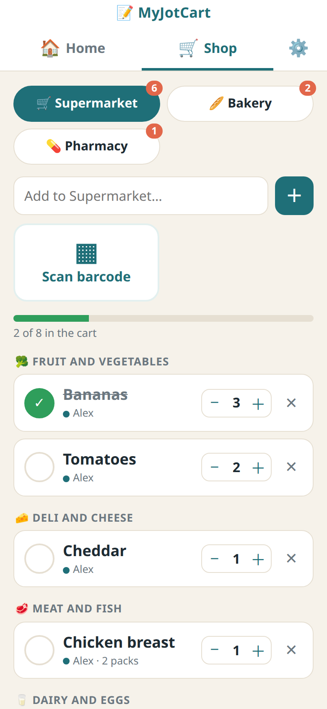

# MyJotCart — Home Assistant add-on repository

**The shopping list your whole household actually uses** — shared lists per store and a home pantry that refills itself, running inside your own Home Assistant. No cloud account, no subscription.

| Home pantry | Shopping list |
|---|---|
|  |  |

## Features

- **One list per store** (supermarket, bakery, pharmacy…). Everyone in the house adds things from their phone and sees changes instantly. Items are grouped by aisle, in the order you walk the shop.
- **Shop mode**: tick items as they go into the cart, with a progress bar. *Finish shopping* moves what you bought into the home pantry.
- **Home pantry**: how much you have of each product, a minimum, and how many days one unit lasts. MyJotCart counts it down by itself and, when something runs low, puts it on its list.
- **Barcode scanner** with the phone camera, or a small ESP32 scanner in the kitchen: scan something when it's used up and it's added to the list.
- **Made for families**: each person has a name and a short PIN. Works for non-admin Home Assistant users too.
- **In the Home Assistant sidebar** and in the Home Assistant app — also from outside home whenever your Home Assistant is reachable. No extra port or login.
- **Your data stays home**: everything is stored in the add-on and included in Home Assistant backups. There's also a backup/restore file in Settings.
- **5 languages**: English, Español, Deutsch, Français, Português.

## Install

Requires **Home Assistant OS or Supervised** (add-ons).

1. Click the **Add repository** button above, or go to **Settings → Add-ons → Add-on store → ⋮ → Repositories** and add
   `https://github.com/cleydar-creator/myjotcart-addon`
2. Find **MyJotCart** in the store, click **Install**, then **Start**.
3. **MyJotCart** appears in the sidebar (cart icon). If it doesn't: add-on page → turn on **Show in sidebar**.
4. Create your user with a 4–8 digit PIN, then add the rest of the household in **Settings**.

On phones, open it from the Home Assistant app's side menu, or add it to the home screen (Safari: Share → *Add to Home Screen*; Chrome: ⋮ → *Add to Home screen*). Live camera scanning needs **https** (Nabu Casa or your own domain); without https you can type the code or use a photo.

## Add-on or integration? (you can have both)

| | **MyJotCart add-on** (this repository) | **[MyJotCart integration](https://github.com/cleydar-creator/myjotcart-ha)** (HACS) |
|---|---|---|
| What it is | The app itself: it runs MyJotCart and keeps your data | A connector between MyJotCart and Home Assistant |
| Where you see it | **MyJotCart** in the sidebar (cart icon) | Your lists under **To-do lists**, plus a dashboard card |
| What it adds | Lists, home pantry, barcode scanner, settings | Voice with Assist (*"add milk to my supermarket list"*), sensors for automations, the *MyJotCart* dashboard card |
| Needed? | Yes | Optional |

With the integration installed, Home Assistant finds the add-on by itself: **Settings → Devices & services → Discovered → MyJotCart → Add**.

## Free and Pro

Everything above is **free**. **MyJotCart Pro** unlocks the AI features — for the price of a coffee (**€2.50, one-time, one home**) at [myjotcart.com](https://myjotcart.com/#pro):

- 📷 **Photo → product**: take a picture and it's recognised.
- 🧾 **Receipts and invoices**: a photo or PDF adds what you bought to the pantry and keeps prices per store. The image is not stored.
- 🍳 **Recipes**: checks what you have at home and adds what's missing to your list.
- 🗂️ **Smart aisles**: new products go to the right aisle automatically.

AI uses **your own** Claude, ChatGPT or Gemini API key (cents per receipt, billed by the provider). Activate the key in **Settings → Artificial intelligence**; it needs internet once, then it's checked locally.

## Support

Questions and ideas: open an [issue](https://github.com/cleydar-creator/myjotcart-addon/issues).
